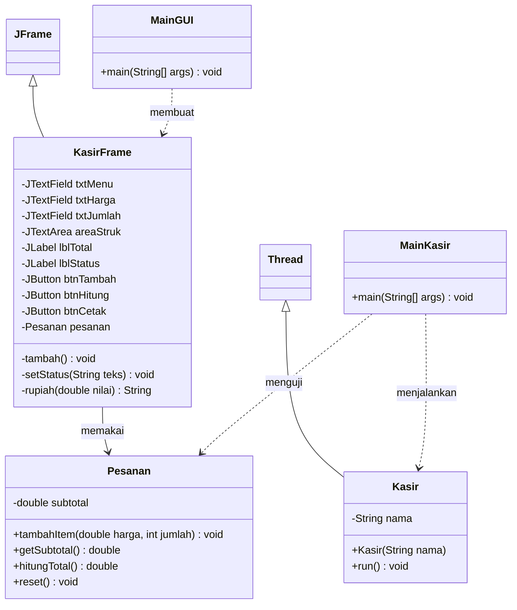
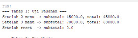
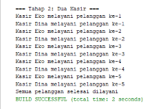
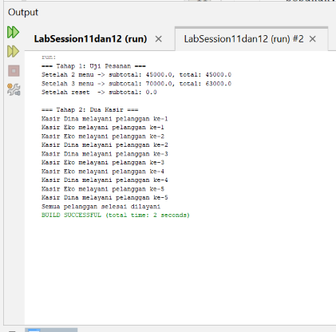
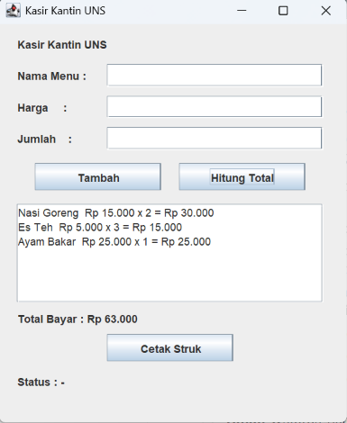
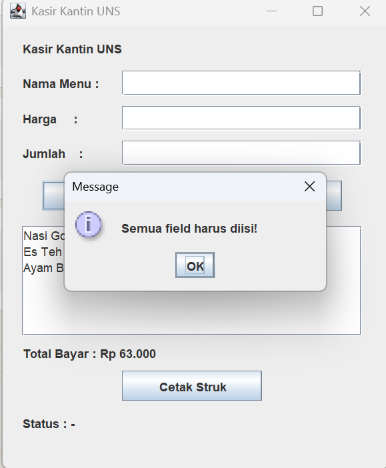
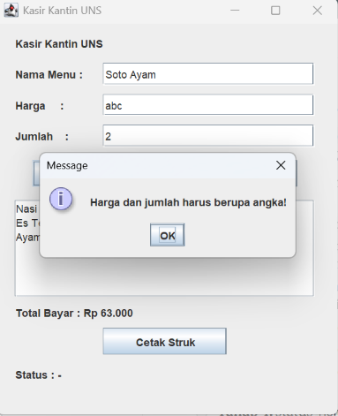
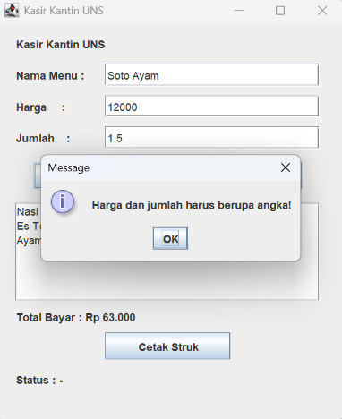
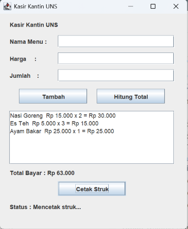
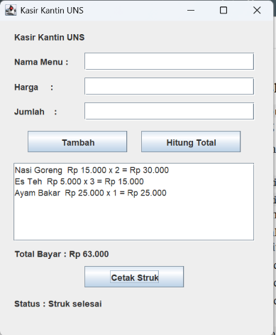

# Kasir Kantin UNS

Aplikasi kasir sederhana berbasis Java Swing untuk **Praktikum Pemrograman Berorientasi Objek (PBO) Kelas 3B, Pertemuan 11 (Multithreading) dan Pertemuan 12 (GUI Programming)**. Aplikasi dikerjakan bertahap dari Tahap 1 sampai Tahap 4 sesuai dokumen `LAB SESSION P11-12(1).pdf`.

| | |
|---|---|
| **Nama** | Febrian Zaki Hidayatulloh |
| **NIM** | L0325045 |
| **Program Studi** | Informatika PSDKU Kebumen, Universitas Sebelas Maret |
| **Kelas** | 3B |
| **Mata Kuliah** | Pemrograman Berorientasi Objek |
| **Package** | `lab.kasir` |

---

## Daftar Isi

1. [Deskripsi Singkat](#1-deskripsi-singkat)
2. [Fitur](#2-fitur)
3. [Teknologi dan Prasyarat](#3-teknologi-dan-prasyarat)
4. [Struktur Project](#4-struktur-project)
5. [Arsitektur dan Diagram Class](#5-arsitektur-dan-diagram-class)
6. [Kompilasi dan Menjalankan](#6-kompilasi-dan-menjalankan)
7. [Penjelasan Tiap Tahap](#7-penjelasan-tiap-tahap)
8. [Konsep PBO yang Diterapkan](#8-konsep-pbo-yang-diterapkan)
9. [Data Uji dan Hasil yang Diharapkan](#9-data-uji-dan-hasil-yang-diharapkan)
10. [Skenario Pengujian](#10-skenario-pengujian)
11. [Panduan Screenshot untuk Laporan](#11-panduan-screenshot-untuk-laporan)
12. [Batasan dan Catatan Penting](#12-batasan-dan-catatan-penting)
13. [Pemecahan Masalah](#13-pemecahan-masalah)
14. [Pengembangan Lanjutan](#14-pengembangan-lanjutan)

---

## 1. Deskripsi Singkat

Kantin UNS membutuhkan aplikasi kasir berbasis jendela. Kasir memasukkan nama menu, harga, dan jumlah, lalu aplikasi menghitung total bayar lengkap dengan diskon. Project ini juga memuat:

- simulasi **dua kasir yang melayani pelanggan secara bersamaan** menggunakan thread, dan
- fitur **cetak struk** yang berjalan di thread terpisah sehingga jendela tidak macet.

## 2. Fitur

| Tahap | Fitur | Topik |
|---|---|---|
| 1 | Class `Pesanan`: hitung subtotal, diskon 10% bila subtotal > Rp50.000, reset | Class, enkapsulasi, method |
| 2 | Dua kasir (Dina dan Eko) berjalan bersamaan, `main` menunggu keduanya selesai | `extends Thread`, `start()`, `sleep()`, `join()` |
| 3 | GUI kasir: input menu, harga, jumlah, area struk, total bayar, validasi input | Swing, `setBounds()`, `ActionListener`, `JOptionPane`, `try-catch` |
| 4 | Tombol Cetak Struk dengan status "Mencetak struk..." lalu "Struk selesai" | Thread terpisah, Event Dispatch Thread (EDT), `SwingUtilities.invokeLater()` |

## 3. Teknologi dan Prasyarat

- **Bahasa:** Java
- **Library GUI:** Java Swing (`javax.swing`), sudah termasuk di JDK
- **Versi minimum:** JDK 8 atau lebih baru (kode memakai lambda dan `Locale.forLanguageTag`)
- **Tanpa dependensi eksternal** dan tanpa build tool, cukup `javac` dan `java`
- **Lingkungan GUI:** perlu layar grafis (tidak bisa dijalankan pada terminal tanpa display / headless)

Cek versi Java:

```bash
java -version
javac -version
```

## 4. Struktur Project

```text
KasirKantinUNS/
├── README.md
├── Template_Laporan.md
├── images/                   # screenshot hasil pengujian untuk laporan
├── out/                      # hasil kompilasi (dibuat saat javac dijalankan)
└── src/
    └── lab/
        └── kasir/
            ├── Pesanan.java      # Tahap 1: logika subtotal, diskon, reset
            ├── Kasir.java        # Tahap 2: thread kasir
            ├── MainKasir.java    # Tahap 1 & 2: program uji berbasis konsol
            ├── KasirFrame.java   # Tahap 3 & 4: jendela GUI
            └── MainGUI.java      # Tahap 3 & 4: titik masuk GUI
```

> Semua class berada dalam satu package `lab.kasir`, sehingga setiap file harus berada di folder `src/lab/kasir/` dan baris pertamanya adalah `package lab.kasir;`.

| File | Tanggung jawab |
|---|---|
| `Pesanan.java` | Menyimpan `subtotal`, menambah item, menghitung total setelah diskon, mereset |
| `Kasir.java` | Subclass `Thread` yang mencetak "Kasir *nama* melayani pelanggan ke-*i*" sebanyak 5 kali, jeda 500 ms |
| `MainKasir.java` | Menguji logika `Pesanan` (Tahap 1) lalu menjalankan dua thread kasir (Tahap 2) |
| `KasirFrame.java` | Membangun jendela Swing, menangani event tombol, validasi, dan cetak struk |
| `MainGUI.java` | Membuka `KasirFrame` di Event Dispatch Thread |

## 5. Arsitektur dan Diagram Class



### Alur Tahap 1 dan 2 (konsol)

```text
MainKasir.main()
   ├── Pesanan.tambahItem() x3  ->  getSubtotal() / hitungTotal()  ->  reset()
   ├── new Kasir("Dina").start()  ─┐  berjalan bersamaan
   ├── new Kasir("Eko").start()   ─┘
   ├── dina.join(), eko.join()      main menunggu
   └── print "Semua pelanggan selesai dilayani"
```

### Alur Tahap 3 dan 4 (GUI)

```text
MainGUI.main()
   └── SwingUtilities.invokeLater -> new KasirFrame()   (berjalan di EDT)

Klik [Tambah]       -> validasi -> Pesanan.tambahItem() -> tulis baris ke areaStruk -> kosongkan field
Klik [Hitung Total] -> Pesanan.hitungTotal() -> lblTotal
Klik [Cetak Struk]  -> new Thread(...).start()
                          ├── setStatus("Mencetak struk...")
                          ├── Thread.sleep(2000)            (di thread baru, EDT bebas)
                          └── setStatus("Struk selesai")    (via invokeLater ke EDT)
```

## 6. Kompilasi dan Menjalankan

Jalankan semua perintah dari folder root project (`KasirKantinUNS/`).

### Kompilasi

```bash
javac -d out src/lab/kasir/*.java
```

Opsi `-d out` menaruh file `.class` ke `out/lab/kasir/` sesuai nama package. Pada Windows PowerShell atau CMD, ganti pola `*.java` bila perlu dengan:

```bash
javac -d out src\lab\kasir\Pesanan.java src\lab\kasir\Kasir.java src\lab\kasir\MainKasir.java src\lab\kasir\KasirFrame.java src\lab\kasir\MainGUI.java
```

### Menjalankan Tahap 1 dan 2 (konsol)

```bash
java -cp out lab.kasir.MainKasir
```

### Menjalankan Tahap 3 dan 4 (GUI)

```bash
java -cp out lab.kasir.MainGUI
```

> Gunakan **nama class lengkap dengan package** (`lab.kasir.MainKasir`), bukan `MainKasir` saja, dan jalankan dari folder root project, bukan dari dalam `out/`.

### Menjalankan di IDE (NetBeans / IntelliJ / VS Code / Eclipse)

1. Buat project Java kosong, lalu salin folder `lab/kasir/` ke direktori `src`.
2. Pastikan package terbaca sebagai `lab.kasir`.
3. Jalankan `MainKasir` untuk Tahap 1 dan 2, dan `MainGUI` untuk Tahap 3 dan 4.

## 7. Penjelasan Tiap Tahap

### Tahap 1: Class Logika `Pesanan`

| Member | Keterangan |
|---|---|
| `private double subtotal` | Menyimpan akumulasi harga x jumlah, nilai awal 0 |
| `tambahItem(double harga, int jumlah)` | `subtotal += harga * jumlah` |
| `getSubtotal()` | Mengembalikan nilai subtotal |
| `hitungTotal()` | Jika `subtotal > 50000` maka `subtotal - (subtotal * 0.10)`, selain itu `subtotal` |
| `reset()` | Mengembalikan `subtotal` ke 0 |

Aturan diskon memakai **lebih dari** (`>`), jadi subtotal tepat Rp50.000 **belum** mendapat diskon.

| Subtotal | Diskon | Total |
|---:|---:|---:|
| 45.000 | 0 | 45.000 |
| 50.000 | 0 | 50.000 |
| 50.001 | 10% | 45.000,9 |
| 70.000 | 7.000 | 63.000 |

### Tahap 2: Dua Kasir sebagai Thread

- `Kasir` mewarisi `Thread` dan meng-*override* `run()`.
- Setiap kasir mengulang 5 kali: mencetak `Kasir <nama> melayani pelanggan ke-<i>`, lalu `Thread.sleep(500)`.
- `MainKasir` membuat `Kasir("Dina")` dan `Kasir("Eko")`, memanggil `start()` pada keduanya, lalu `join()` pada keduanya.
- Pesan `Semua pelanggan selesai dilayani` dicetak setelah kedua `join()` selesai, sehingga **selalu paling akhir**.

**Contoh output (urutan Dina/Eko dapat berbeda tiap eksekusi):**

```text
=== Tahap 1: Uji Pesanan ===
Setelah 2 menu -> subtotal: 45000.0, total: 45000.0
Setelah 3 menu -> subtotal: 70000.0, total: 63000.0
Setelah reset  -> subtotal: 0.0

=== Tahap 2: Dua Kasir ===
Kasir Dina melayani pelanggan ke-1
Kasir Eko melayani pelanggan ke-1
Kasir Eko melayani pelanggan ke-2
Kasir Dina melayani pelanggan ke-2
...
Kasir Dina melayani pelanggan ke-5
Kasir Eko melayani pelanggan ke-5
Semua pelanggan selesai dilayani
```

### Tahap 3: Tampilan GUI Kasir

Jendela berukuran 400 x 480 piksel dengan layout `null` dan posisi komponen diatur memakai `setBounds()`.

| Komponen | Jenis | Fungsi |
|---|---|---|
| Judul | `JLabel` | "Kasir Kantin UNS" |
| Nama Menu | `JTextField` (`txtMenu`) | Input nama menu |
| Harga | `JTextField` (`txtHarga`) | Input harga satuan |
| Jumlah | `JTextField` (`txtJumlah`) | Input jumlah porsi |
| Tambah | `JButton` (`btnTambah`) | Validasi, tambah ke `Pesanan`, tulis baris ke area struk, kosongkan field |
| Hitung Total | `JButton` (`btnHitung`) | Tampilkan `pesanan.hitungTotal()` pada label total |
| Area struk | `JTextArea` di dalam `JScrollPane` | Daftar item (tidak bisa diedit) |
| Total Bayar | `JLabel` (`lblTotal`) | Menampilkan total, contoh `Total Bayar : Rp 63.000` |

**Validasi input (`tambah()`):**

1. Jika salah satu field kosong, muncul dialog `Semua field harus diisi!`.
2. Jika harga atau jumlah bukan angka, `NumberFormatException` ditangkap dan muncul dialog `Harga dan jumlah harus berupa angka!`.

**Format rupiah** memakai `NumberFormat` dengan locale `id-ID` (pemisah ribuan titik) dan nol angka desimal, misalnya `Rp 15.000`.

### Tahap 4: Tombol Cetak Struk dengan Thread

```java
btnCetak.addActionListener(e -> {
    new Thread(() -> {
        setStatus("Mencetak struk...");
        try { Thread.sleep(2000); } catch (InterruptedException ex) { }
        setStatus("Struk selesai");
    }).start();
});
```

- `Thread.sleep(2000)` dijalankan di **thread baru**, bukan di Event Dispatch Thread (EDT).
- Karena EDT tidak ditahan, tombol **Tambah** dan **Hitung Total** tetap responsif selama 2 detik penantian.
- Perubahan teks label dilakukan lewat `SwingUtilities.invokeLater(...)` pada method `setStatus()`, karena komponen Swing hanya aman diubah dari EDT.

## 8. Konsep PBO yang Diterapkan

| Konsep | Penerapan di project |
|---|---|
| **Enkapsulasi** | Semua atribut `private` (`subtotal`, `nama`, komponen GUI), diakses lewat method |
| **Inheritance** | `Kasir extends Thread`, `KasirFrame extends JFrame` |
| **Polimorfisme (overriding)** | `@Override public void run()` pada `Kasir` |
| **Abstraksi** | `Pesanan` menyembunyikan aturan diskon di balik `hitungTotal()` |
| **Package** | Seluruh class dalam `lab.kasir` |
| **Multithreading** | `Thread`, `start()`, `sleep()`, `join()` |
| **Exception handling** | `NumberFormatException` pada input, `InterruptedException` pada `sleep()` dan `join()` |
| **Event-driven programming** | `ActionListener` dengan ekspresi lambda |
| **Thread safety GUI** | Perubahan label dari thread lain dibungkus `SwingUtilities.invokeLater()` |

### Perbedaan `start()` dan `run()`

| | `start()` | `run()` |
|---|---|---|
| Efek | Membuat thread baru, lalu menjalankan `run()` di thread tersebut | Hanya pemanggilan method biasa di thread pemanggil |
| Hasil pada Tahap 2 | Dina dan Eko berjalan bersamaan | Berjalan berurutan, Dina selesai dulu baru Eko |

### Peran `join()`

Tanpa `join()`, `main` dapat mencetak `Semua pelanggan selesai dilayani` **sebelum** kedua kasir selesai. Dengan `join()`, thread `main` menunggu sampai thread yang bersangkutan berakhir.

## 9. Data Uji dan Hasil yang Diharapkan

| Menu | Harga | Jumlah | Subtotal |
|---|---:|---:|---:|
| Nasi Goreng | 15.000 | 2 | 30.000 |
| Es Teh | 5.000 | 3 | 15.000 |
| Ayam Bakar | 25.000 | 1 | 25.000 |

| Kondisi | Subtotal | Diskon | Total |
|---|---:|---:|---:|
| Setelah Nasi Goreng dan Es Teh | 45.000 | 0 | **45.000** |
| Setelah Ayam Bakar | 70.000 | 7.000 (10%) | **63.000** |

> **Penting saat mengisi field Harga di GUI:** ketik `15000`, **bukan** `15.000`. `Double.parseDouble("15.000")` membaca titik sebagai tanda desimal sehingga hasilnya 15,0 dan total akan salah.

## 10. Skenario Pengujian

### A. Pengujian Tahap 1 dan 2 (konsol)

| No | Langkah | Hasil yang diharapkan |
|---|---|---|
| A1 | Jalankan `MainKasir` | Setelah 2 menu: subtotal 45000.0, total 45000.0 |
| A2 | (lanjutan) | Setelah 3 menu: subtotal 70000.0, total 63000.0 |
| A3 | (lanjutan) | Setelah `reset()`: subtotal 0.0 |
| A4 | Jalankan `MainKasir` dua kali | Urutan baris Dina/Eko dapat berbeda antar eksekusi |
| A5 | Perhatikan baris terakhir | `Semua pelanggan selesai dilayani` selalu paling akhir |

### B. Pengujian GUI (Tahap 3)

| No | Langkah | Hasil yang diharapkan |
|---|---|---|
| B1 | Tambah ketiga menu data uji, klik **Hitung Total** | Label: `Total Bayar : Rp 63.000` |
| B2 | Klik **Tambah** dengan semua field kosong | Dialog `Semua field harus diisi!` |
| B3 | Isi nama menu saja, field lain kosong | Dialog `Semua field harus diisi!` |
| B4 | Harga `abc`, jumlah `2` | Dialog `Harga dan jumlah harus berupa angka!` |
| B5 | Harga `15000`, jumlah `1.5` | Dialog `Harga dan jumlah harus berupa angka!` |
| B6 | Harga `15000`, jumlah `2` | Baris item muncul di area struk dan semua field dikosongkan |
| B7 | Klik **Hitung Total** tanpa item | Label: `Total Bayar : Rp 0` |

### C. Pengujian Thread GUI (Tahap 4)

| No | Langkah | Hasil yang diharapkan |
|---|---|---|
| C1 | Klik **Cetak Struk** | Status: `Status : Mencetak struk...` |
| C2 | Dalam 2 detik, klik **Tambah** / **Hitung Total** | Tombol tetap merespons, jendela tidak macet |
| C3 | Tunggu 2 detik | Status: `Status : Struk selesai` |

### D. Pengujian Batas Diskon

| Subtotal uji | Hasil total |
|---:|---:|
| 50.000 (misalnya harga 50000, jumlah 1) | 50.000 (tanpa diskon) |
| 50.001 | Diskon 10% diterapkan |

## 11. Panduan Screenshot untuk Laporan

Gunakan `Template_Laporan.md` sebagai kerangka laporan. Berikut sembilan screenshot hasil pengujian yang sudah diambil (file ada di folder `images/`).

### Tahap 1: Output pengujian `Pesanan`



*Gambar 1. Setelah 2 menu: subtotal 45000.0 dan total 45000.0 (tanpa diskon). Setelah 3 menu: subtotal 70000.0 dan total 63000.0 (diskon 10%). Setelah `reset()`: subtotal 0.0.*

### Tahap 2: Dua kasir sebagai thread



*Gambar 2. Eksekusi pertama `MainKasir`: pada tiap pelanggan, Eko tampil lebih dulu daripada Dina.*



*Gambar 3. Eksekusi kedua `MainKasir`: urutan berubah, Dina tampil lebih dulu pada pelanggan ke-1 dan ke-3.*

| Pengamatan | Eksekusi 1 | Eksekusi 2 |
|---|---|---|
| Urutan output Dina dan Eko | Eko lebih dulu pada pelanggan ke-1 dan ke-3 | Dina lebih dulu pada pelanggan ke-1 dan ke-3 |
| Pesan selesai tampil paling akhir? | Ya | Ya |

Urutan output tidak dijamin sama karena penjadwalan thread, sedangkan `Semua pelanggan selesai dilayani` selalu paling akhir berkat `join()`.

### Tahap 3: GUI dan validasi input



*Gambar 4. Setelah Nasi Goreng, Es Teh, dan Ayam Bakar ditambahkan lalu Hitung Total ditekan, label menampilkan `Total Bayar : Rp 63.000`.*



*Gambar 5. Field kosong: muncul dialog `Semua field harus diisi!`.*



*Gambar 6. Harga `abc`: muncul dialog `Harga dan jumlah harus berupa angka!`.*



*Gambar 7. Jumlah `1.5` (harga `12000`): muncul dialog yang sama, sehingga bilangan desimal pada jumlah ditolak.*

Pada ketiga kasus validasi, area struk tetap berisi tiga item semula dan `Total Bayar` tetap Rp 63.000, artinya data yang salah tidak masuk ke pesanan.

### Tahap 4: Cetak struk dengan thread



*Gambar 8. Setelah Cetak Struk ditekan, status menjadi `Status : Mencetak struk...`.*



*Gambar 9. Setelah 2 detik, status berubah menjadi `Status : Struk selesai`.*

> Kesimpulan laporan ditulis berdasarkan hasil eksekusi dan screenshot di atas.

## 12. Batasan dan Catatan Penting

Poin berikut adalah perilaku program saat ini, berguna untuk dipahami saat pengujian dan pembahasan di laporan:

1. **Format harga:** input harga harus angka polos tanpa pemisah ribuan (`15000`). Koma dan titik ribuan tidak dikenali.
2. **Nilai nol dan negatif:** `KasirFrame` belum menolak harga atau jumlah `0` atau negatif; nilai tersebut tetap masuk ke subtotal.
3. **Jumlah desimal:** `Integer.parseInt` menolak `1.5`, sehingga muncul dialog kesalahan format.
4. **Total hanya diperbarui saat Hitung Total ditekan:** label total tidak berubah otomatis setelah **Tambah**.
5. **Tombol Cetak Struk tidak dinonaktifkan** selama proses. Klik berulang akan membuat beberapa thread, dan status akan berganti beberapa kali.
6. **Cetak Struk hanya mengubah status;** isi struk tidak dicetak ke area teks dan pesanan tidak direset setelah cetak.
7. **Layout `null`:** posisi komponen tetap (absolut), sehingga tampilan tidak menyesuaikan ukuran jendela.
8. **Thread safety `Pesanan`:** class ini tidak disinkronkan karena hanya diakses dari EDT. Bila dipakai banyak thread, tambahkan `synchronized`.
9. **Tipe `double` untuk uang:** cukup untuk tugas ini, tetapi aplikasi nyata sebaiknya memakai `BigDecimal` atau satuan bilangan bulat (rupiah).
10. **Urutan output Tahap 2 tidak deterministik** karena penjadwalan thread oleh sistem operasi dan JVM.

## 13. Pemecahan Masalah

| Gejala | Penyebab umum | Solusi |
|---|---|---|
| `error: class X is public, should be declared in a file named X.java` | Nama file tidak sama dengan nama class | Samakan nama file dengan nama class (hapus akhiran seperti `_1`) |
| `package lab.kasir does not exist` / `cannot find symbol` | File tidak berada di `src/lab/kasir/` atau tidak ikut dikompilasi | Kompilasi semua file sekaligus dengan `javac -d out src/lab/kasir/*.java` |
| `Error: Could not find or load main class MainKasir` | Dijalankan tanpa nama package | Gunakan `java -cp out lab.kasir.MainKasir` dari folder root |
| `ClassNotFoundException` | Salah folder kerja atau `-cp` salah | Jalankan dari root project dan pastikan `out/lab/kasir/*.class` ada |
| `HeadlessException` | Lingkungan tanpa layar grafis | Jalankan di desktop atau IDE yang punya display |
| Total GUI salah (misalnya Rp 15) | Harga diketik `15.000` | Ketik `15000` |
| Jendela GUI tidak muncul | Exception di konstruktor atau main class salah | Periksa pesan error di konsol, jalankan `lab.kasir.MainGUI` |
| Output Dina/Eko selalu tampak sama urutannya | Kebetulan penjadwalan | Jalankan beberapa kali, urutan dapat berubah |

## 14. Pengembangan Lanjutan

Ide peningkatan bila project ingin dikembangkan:

- Validasi harga dan jumlah harus lebih dari 0.
- Menonaktifkan tombol **Cetak Struk** selama proses (`setEnabled(false)`) lalu mengaktifkannya kembali.
- Mencetak struk lengkap (subtotal, diskon, total, ucapan terima kasih) ke area teks atau file.
- Tombol **Reset Pesanan** yang memanggil `pesanan.reset()` dan mengosongkan area struk.
- Memakai `SwingWorker` untuk proses latar belakang yang melaporkan hasil ke EDT.
- Memakai `ExecutorService` sebagai pengganti pembuatan `Thread` manual.
- Mengganti layout `null` dengan `GridBagLayout` atau `BorderLayout`.
- Memakai `BigDecimal` untuk perhitungan uang.
- Menambahkan pengujian unit (JUnit) untuk `Pesanan.hitungTotal()` termasuk kasus batas 50.000.
- Menyimpan riwayat transaksi ke file atau database.

---

*Dikerjakan untuk keperluan Praktikum PBO Kelas 3B, Pertemuan 11 dan 12, Universitas Sebelas Maret.*
